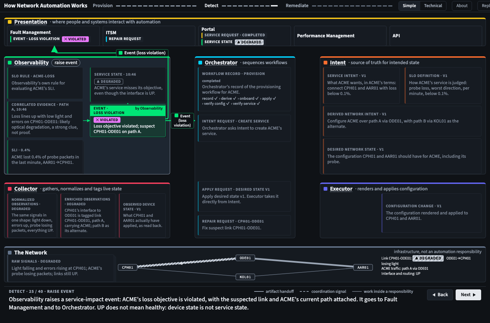

# How Network Automation Works

An interactive explainer of network automation as separate **responsibilities** connected by **typed handoffs**, based on the [Network Automation Forum (NAF) framework](https://reference.networkautomation.forum/Framework/Framework/). One continuous story follows an ACME L3VPN service through **Provision → Detect → Remediate**.

**Try it:** https://naf-explorer.brian-1e1.workers.dev



## What it shows

Automation is easier to reason about as roles and handoffs than as a list of tools. And "the interface is UP" is not the same as "the service is healthy".

- **Provision:** ACME's request becomes intended state, desired configuration, an applied change, a verified configuration and finally a verified, healthy service.
- **Detect:** a fibre starts losing light. Network signals become measurements, then service understanding: the link stays UP, but ACME's service is degraded and its objective is violated.
- **Remediate:** a pre-approved policy moves ACME to a healthy alternate path and verifies the result. The fibre still needs repair, and its ticket is already open.

Six NAF responsibilities (Presentation, Intent, Orchestrator, Executor, Collector, Observability) and The Network sit on one persistent canvas. Every step adds at most one new artifact per responsibility, so the cause and effect stay readable. Colour always means who produced something; status is always an icon and a word.

This is an example of how good network automation can look when NAF is used as the reference. It is not a prescription for how network automation should look. Where the canvas takes liberties (for example, ITSM sits in the Presentation band although it is usually its own platform), the app says so.

**Who it is for:** network engineers, architects and senior technical leadership who know networking and want a clear mental model of how automation systems divide the work. Software and automation engineers are welcome too.

## Using it

- **→ / ←** (or Next / Back) step through the story; the step ticks at the top jump anywhere.
- **Simple / Technical** changes the depth, never the story. Technical adds identifiers, values and protocol detail.
- **Click or press Enter** on any card, surface, line label or responsibility name to inspect it: what it is, who produced it, who uses it and why.
- **Replay** plays the current step again. Reduced motion is respected: you get the same end state without animation.
- **About** explains the framing and credits; it opens on every load.

It is built for a desktop browser (about 1440×900). The whole stage scales to fit the window.

## Running it locally

You need Node 22.18 or later.

```sh
npm install
npm run dev        # http://localhost:5173
```

| Command            | What it does                                                              |
| ------------------ | ------------------------------------------------------------------------- |
| `npm run dev`      | Vite dev server                                                           |
| `npm run build`    | Production build into `dist/`                                             |
| `npm run preview`  | Serves the build                                                          |
| `npm test`         | Unit tests (Vitest): the NAF rules and the story as data                  |
| `npm run test:e2e` | Browser tests (Playwright, Chromium), including an axe accessibility scan |
| `npm run check`    | Type and Svelte checks                                                    |
| `npm run beats`    | Prints the step table from the scenario data                              |
| `npm run verify`   | Formatting, types, unit tests, build and browser tests in one go          |

Run `npm run verify` before committing. The first browser-test run needs `npx playwright install chromium`.

## How the code is organised

```
src/
  scenario/scenario.ts   the whole story: catalogs, artifacts and the 40 steps (the only story content)
  scenario/types.ts      the vocabulary: responsibilities, artifacts, signals, events
  model/                 derived from the scenario: state at each step, motion timeline, inspector content
  routes.ts, layout.ts   where everything sits and how lines run
  ui/                    Svelte components and the animation overlay
  theme.ts, app.css      colour tokens and styles
tests/unit/              the NAF invariants and story rules, checked over the data
tests/e2e/               walk-through, navigation, inspector, motion, layout and accessibility
```

The story is data. The canvas, the motion, the inspector and the step table are all derived from `scenario.ts`, so changing the story means editing one file, and the tests say whether it still obeys the rules.

## Where the decisions live

- `CLAUDE.md`: the NAF semantic invariants (hard rules) and how work is done in this repo.
- `docs/brief/`: the decided requirements (domain, story, About, acceptance checklist) and guidance.
- `docs/specs/`: the approved design specs.
- `docs/adr/`: architecture decisions, for example why Observability, not Intent, checks configuration conformance (ADR 0006).
- `docs/plans/`: the implementation plans, kept as a record.
- `DESIGN.md` and `PRODUCT.md`: the visual system and the product context.

## Deployment

The site is a static-assets Cloudflare Worker (`wrangler.jsonc`). Cloudflare Workers Builds deploys `main` on every push and posts a preview for each pull request. See ADR 0007.

## Credits

**Built by Brian Strube Jeggesen.** He set the direction and the story, and made the calls. The code and docs were written with [Claude](https://claude.ai) (Anthropic) in Claude Code, working under his direction, review and occasional colourful feedback, and at a token spend that is best not mentioned in polite company.

**Inspired by [How the Internet Works](https://tkjaer.github.io/how-the-internet-works/) by Thomas Kjær Aabo** ([source](https://github.com/tkjaer/how-the-internet-works)). This project grew out of Thomas's explorable, step-by-step picture of a complex system, and his switch between simple and technical explanations. Thank you, Thomas. The same thanks lives in the app's About window.

**Built on the [NAF Automation Framework](https://reference.networkautomation.forum/Framework/Framework/)** by the Network Automation Forum. NAF describes functional responsibilities, not one mandatory design; this explainer is one possible way to show them, and not an official NAF product.

## Licence

[MIT](LICENSE). Use it, change it, present it, learn from it. A link back is appreciated.
